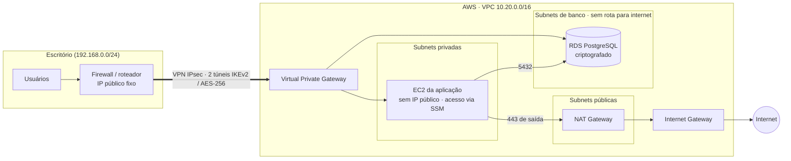

# terraform-aws-hybrid-network

[](https://github.com/murops/terraform-aws-hybrid-network/actions/workflows/terraform-ci.yml)


Infraestrutura como Código para uma **rede híbrida entre um escritório e a AWS**: VPC segmentada em camadas, **VPN site-to-site** com o firewall do escritório, aplicação em EC2 privada e banco PostgreSQL isolado. Tudo em módulos Terraform reutilizáveis, em que **um ambiente novo é só um arquivo de variáveis**.

## Arquitetura



| Camada | O que roda | Rota para a internet | Quem acessa |
|---|---|---|---|
| Pública | NAT Gateway | Internet Gateway | Ninguém |
| Privada | EC2 da aplicação | Só saída, pelo NAT | Escritório pela VPN |
| Banco | RDS PostgreSQL | Nenhuma | Aplicação e escritório pela VPN |

## Estrutura

```
.
├── modules/
│   ├── network/    VPC, subnets em 3 camadas, NAT, rotas e VPC Flow Logs
│   ├── vpn/        Virtual Private Gateway, Customer Gateway e VPN site-to-site
│   ├── compute/    EC2 com IMDSv2, disco criptografado e acesso via SSM
│   └── database/   RDS PostgreSQL com senha gerenciada no Secrets Manager
├── stack/          Composição dos módulos (o que é aplicado)
│   ├── envs/       Variáveis e backend de cada ambiente
│   └── tests/      Testes com provider AWS simulado (terraform test)
└── .github/        CI: fmt, validate, testes, TFLint e Trivy
```

## Um ambiente novo = um arquivo de variáveis

O código é o mesmo para todos os ambientes. O que muda fica em `stack/envs/`:

| | `dev.tfvars` | `prod.tfvars` |
|---|---|---|
| Zonas de disponibilidade | 2 | 3 |
| NAT Gateway | 1 compartilhado | 1 por AZ |
| EC2 | t3.micro | t3.small |
| RDS | db.t4g.micro, single-AZ | db.t4g.small, Multi-AZ |
| Proteção contra exclusão do banco | não | sim |

Para criar um ambiente de homologação, por exemplo, basta copiar `dev.tfvars` para `hml.tfvars`, ajustar CIDRs e tamanhos e criar o `hml.backend.hcl`.

## Como usar

**Pré-requisitos:** Terraform 1.10+, credenciais AWS configuradas e um bucket S3 para o state (com versionamento e bloqueio de acesso público).

```bash
cd stack

# 1. Ajuste o bucket em envs/dev.backend.hcl e os valores do escritório em envs/dev.tfvars
terraform init -backend-config=envs/dev.backend.hcl

# 2. Revise o que será criado
terraform plan -var-file=envs/dev.tfvars -out=dev.tfplan

# 3. Aplique
terraform apply dev.tfplan
```

**Configurando o lado do escritório:**

```bash
terraform output vpn_tunnel_addresses          # IPs dos dois túneis da AWS
terraform output vpn_connection_id             # ID para baixar a configuração no console
```

No console da AWS, em *VPC > Site-to-Site VPN > Download configuration*, a AWS gera a configuração pronta para o modelo do firewall (pfSense, Fortinet, Cisco, MikroTik etc.). Configure **os dois túneis**: a AWS faz manutenção em um de cada vez, e o segundo garante que a conexão não caia.

**Acessando a instância sem SSH:**

```bash
aws ssm start-session --target $(terraform output -raw app_instance_id)
```

**Custo:** NAT Gateway, VPN, EC2 e RDS são cobrados por hora. Ao terminar os testes, rode `terraform destroy -var-file=envs/dev.tfvars`.

## Decisões de segurança

- **VPN restrita a criptografia forte:** IKEv2, AES-256, SHA-2 e grupos Diffie-Hellman 14, 19 e 20, nos dois túneis.
- **Banco sem rota para a internet:** as subnets de banco só falam com a VPC e com o escritório pela VPN.
- **Sem SSH e sem IP público na EC2:** o acesso administrativo é feito pelo SSM Session Manager, com auditoria no CloudTrail.
- **IMDSv2 obrigatório** na EC2, protegendo as credenciais da instância contra ataques SSRF.
- **Criptografia em repouso** no disco da EC2 e no RDS.
- **Senha do banco gerenciada pela AWS** no Secrets Manager (`manage_master_user_password`): ela nunca aparece no código nem no state.
- **Security group padrão da VPC bloqueado** e um security group dedicado por recurso, com o mínimo de portas.
- **VPC Flow Logs** no CloudWatch para auditoria e investigação de tráfego.
- **State remoto criptografado** no S3, com lock nativo (`use_lockfile`).
- **Exceções do scanner documentadas no código:** quando uma regra do Trivy não se aplica, o motivo fica escrito ao lado do recurso.

## CI

A cada push e pull request, o GitHub Actions roda:

1. `terraform fmt` e `terraform validate` em cada módulo e na stack;
2. **`terraform test`** com o provider AWS simulado: confere a lógica da stack (um NAT no dev e um por AZ em prod, propagação das rotas da VPN, validações de entrada) sem credenciais e sem custo;
3. **TFLint** com as regras da AWS (tipos de instância inválidos, boas práticas etc.);
4. **Trivy** em modo config, que falha o pipeline se encontrar problema de segurança de severidade alta ou crítica.

As actions são fixadas por hash de commit, e não por tag, para evitar ataques à cadeia de suprimentos.

## Licença

[MIT](LICENSE)
